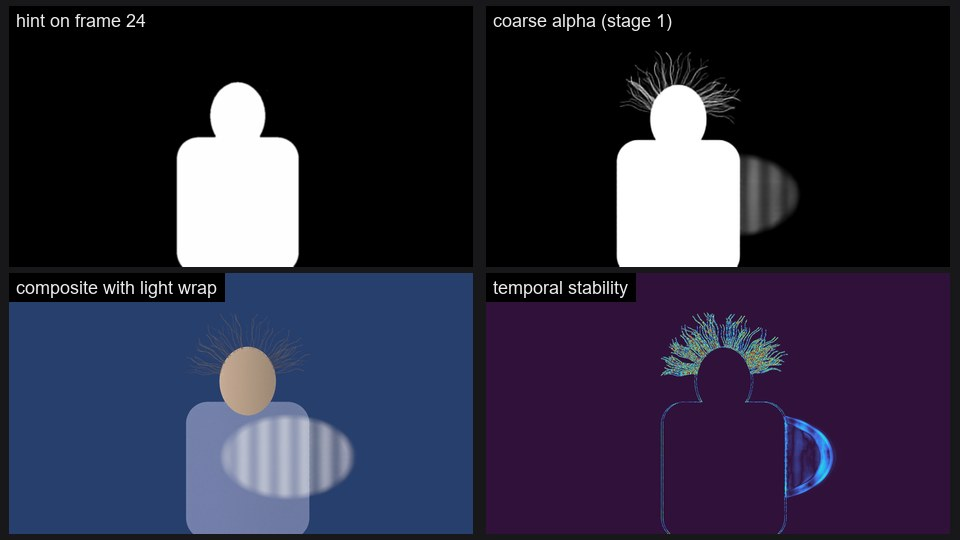

# ComfyUI-CorridorKey2.0

ComfyUI nodes for **[CorridorKey 2.0](https://github.com/nikopueringer/CorridorKey2.0)**, Corridor Digital's
neural green/blue-screen keyer. Key whole clips with temporal consistency, guide the key with alpha hints on any
frame, inspect the depth, normals, semantic and motion features the model is built on, clean up and composite
the result, and fine-tune the model on your own shots.

> Unofficial integration. Not affiliated with, sponsored by or endorsed by Corridor Digital.



## Contents

- [Features](#features)
- [Requirements](#requirements)
- [Installation](#installation)
- [Models](#models)
- [Quick start](#quick-start)
- [Nodes](#nodes)
- [Alpha hints](#alpha-hints)
- [Temporal windows and VRAM](#temporal-windows-and-vram)
- [RAM and long clips](#ram-and-long-clips)
- [Colour, HDR and despill](#colour-hdr-and-despill)
- [Fine-tuning](#fine-tuning)
- [From the CorridorKey command line](#from-the-corridorkey-command-line)
- [Troubleshooting](#troubleshooting)
- [Development](#development)
- [Credits](#credits)
- [Licence](#licence)

## Features

| Capability | What you get |
|---|---|
| **Keying** | **CorridorKey 2.0 (Basic)** works out of the box: clip in, foreground, alpha and RGBA out. **CorridorKey 2.0 (Advanced)** exposes every inference control. |
| **Alpha hints** | Hint on the first frame, on every frame, or on any keyframes (`0, 48, 120`) with propagation **forwards and backwards** in time. Hint quality, hint carry between windows, grow/shrink and blur. **Hint Prep** and **Chroma Hint** nodes make hints from any mask or from the screen colour. |
| **Temporal awareness** (spatio-temporal attention) | Choose the stage-1 attention window (80/40 down to per-frame), or let it pick the largest that fits your GPU. Hann-window blending, exact low-VRAM staging, and a **Temporal Stability** node that measures flicker. |
| **Semantic identity** | **Semantic Identity** shows the C-RADIOv4 features as a stable colour video and turns one reference mask into a per-frame subject mask. |
| **Depth information** and **surface orientation** | **Depth & Normals** runs the MoGe-2 model inside CorridorKey for clip-consistent depth and normal maps. Its geometry output plugs into ComfyUI's MoGe nodes (render, mesh export). |
| **Motion tracking** | **Motion Tracking** uses the RVM video model: identity features, motion energy, and a reference mask tracked through the clip, usable as a keying hint. |
| **Advanced training losses** | **Fine-Tune (Basic)** and **Fine-Tune (Advanced)** train a LoRA on your shot with alpha, edge-band, Laplacian-pyramid, gradient, composition, foreground, temporal-coherence and deep-supervision losses. |
| **Matte clean-up** | **Matte Refine** (clip, despeckle, fill holes, choke, soften, temporal smoothing, garbage and holdout mattes), **Despill**, and **Composite** with light wrap. These run on the keyer's outputs, so tweaking them never re-runs the model. |
| **Demo clip** | A synthetic green-screen shot with hair, a veil, spill, noise and its exact matte, so every workflow can be tried and measured without footage. |

## Requirements

- An NVIDIA GPU, RTX 30-series or newer. CorridorKey 2.0 needs about 4 GB of VRAM for footage up to 1440p and
  6 GB for 4K in low-VRAM mode; more VRAM allows longer temporal windows. Fine-tuning needs about 6 to 8 GB.
- ComfyUI 0.25.0 or newer. Tested with ComfyUI 0.42.0, PyTorch 2.11 (CUDA) and Python 3.12 on Windows 11 with
  an RTX 4090.
- About 5.1 GB of disk space for the model files, and enough RAM for your clip (see
  [RAM and long clips](#ram-and-long-clips)).

## Installation

**ComfyUI Manager:** *Custom Nodes Manager → Install via Git URL* and paste
`https://github.com/marawan206/ComfyUI-CorridorKey2.0`, then restart ComfyUI.

**Manual:**

```bash
cd ComfyUI/custom_nodes
git clone https://github.com/marawan206/ComfyUI-CorridorKey2.0
pip install -r ComfyUI-CorridorKey2.0/requirements.txt
```

**Windows portable build** (from the folder that contains `python_embeded`):

```bat
cd ComfyUI\custom_nodes
git clone https://github.com/marawan206/ComfyUI-CorridorKey2.0
..\..\python_embeded\python.exe -m pip install -r ComfyUI-CorridorKey2.0\requirements.txt
```

The requirements are small (`safetensors`, `einops`, `timm`, `scipy`, `opencv-python`, `huggingface_hub`) and
are usually already installed with ComfyUI. Nothing pins `torch`, `numpy` or `transformers`.

## Models

**CorridorKey 2.0 Load Model** downloads everything on first use (`auto_download`, on by default), with a
progress bar. An interrupted download resumes where it stopped. Files go to `ComfyUI/models/corridorkey2/`:

```
models/corridorkey2/
├── corridorkey_v2.safetensors                    2.66 GB  CorridorKey 2.0 weights
├── foundation_stats.safetensors                  19 KB    feature statistics
├── foundations/
│   ├── cradio/C-RADIOv4-SO400M/                  1.72 GB  NVIDIA C-RADIOv4-SO400M
│   ├── moge/model.pt                             0.42 GB  Microsoft MoGe-2 ViT-B (normal)
│   └── rvm/pretrain_rvm_small16_256_204031069.npz 0.27 GB  Google DeepMind RVM small
└── loras/                                                 your fine-tuned LoRAs
```

| File | Source |
|---|---|
| CorridorKey 2.0 weights and statistics | [nikopueringer/CorridorKey2.0](https://huggingface.co/nikopueringer/CorridorKey2.0) (pinned revision) |
| C-RADIOv4-SO400M | [nvidia/C-RADIOv4-SO400M](https://huggingface.co/nvidia/C-RADIOv4-SO400M) (pinned revision) |
| MoGe-2 ViT-B normal | [Ruicheng/moge-2-vitb-normal](https://huggingface.co/Ruicheng/moge-2-vitb-normal) (pinned revision) |
| RVM small | [google-deepmind/representations4d](https://github.com/google-deepmind/representations4d) (checksum verified) |

To download ahead of time, for example on a machine that will run offline, run this from the `ComfyUI` folder
(on the Windows portable build, use `..\python_embeded\python.exe` instead of `python`):

```bash
python custom_nodes/ComfyUI-CorridorKey2.0/scripts/download_models.py models/corridorkey2
```

Other CorridorKey 2.0 runtime checkpoints named `corridorkey*.safetensors` placed next to
`corridorkey_v2.safetensors` show up in the loader's `weights` list.

## Quick start

1. Restart ComfyUI after installing.
2. Open **Workflow → Browse Templates**, find **ComfyUI-CorridorKey2.0** under custom nodes, and load
   **01_basic_keying**. It uses the Demo Clip node, so it runs without any footage.
3. Press **Run**. The first run downloads the model (about 5 GB). The keyed RGBA frames are saved as PNGs in
   `output/corridorkey2`.
4. For your own shot, replace **Demo Clip** with **Load Video → Get Video Components** (or any image-sequence
   loader) and connect its `images`.

The four example workflows in [`example_workflows/`](example_workflows):

| Workflow | Shows |
|---|---|
| `01_basic_keying` | Load Model → Basic keyer → RGBA PNG sequence |
| `02_advanced_keyframes_refine` | A hint on frame 24 propagated both ways, Matte Refine, Despill, Composite with light wrap, Temporal Stability scores |
| `03_depth_semantic_motion` | Depth & Normals (with the core MoGe renderer), Semantic Identity, Motion Tracking, and the tracked mask used as a keying hint |
| `04_finetune_lora` | Fine-Tune (Basic) → LoRA → keyer, with the loss graph, the check loss before and after training, and matte scores |

## Nodes

All nodes are in the **CorridorKey 2.0** category. Hover any input for a tooltip.

| Node | Purpose |
|---|---|
| **CorridorKey 2.0 Load Model** | Downloads (if needed) and loads the model. Advanced: `keep_on_gpu`, `vram_reserve_gb`. |
| **CorridorKey 2.0 (Basic)** | Keyer with automatic memory settings. Optional `alpha_hint`, a `hint_quality` preset, `invert_hint`, `despill`, `screen`. Outputs `foreground` (despilled, straight sRGB), `alpha`, `rgba`. |
| **CorridorKey 2.0 (Advanced)** | Keyer with every inference control (below). Outputs `foreground` (raw, straight), `alpha`, `coarse_alpha`, `decision_matte`, `info`. |
| **CorridorKey 2.0 LoRA** | Applies a LoRA from `models/corridorkey2/loras` and/or one straight from a fine-tune node, with `strength`. |
| **CorridorKey 2.0 Hint Prep** | Turns any mask into a hint: pick a frame, invert, threshold, grow/shrink, blur, match the clip's size and length. |
| **CorridorKey 2.0 Chroma Hint** | Quick difference key that gives a rough subject hint without painting one. |
| **CorridorKey 2.0 Matte Refine** | Clip black/white (with edge rollback), despeckle, fill holes, choke, soften, temporal smoothing, garbage and holdout mattes. |
| **CorridorKey 2.0 Despill** | Removes screen spill: average (CorridorKey's own), max or min limiting, optionally adding the removed spill to the other two channels. Keeps the alpha channel of RGBA input. |
| **CorridorKey 2.0 Composite** | Linear-light composite over a checkerboard, a colour or a background clip, with light wrap; also outputs straight or premultiplied RGBA. |
| **CorridorKey 2.0 Depth & Normals** | MoGe-2 depth and normal maps with a locked camera for steady clips; `geometry` is ComfyUI's `MOGE_GEOMETRY`. |
| **CorridorKey 2.0 Semantic Identity** | C-RADIOv4 features as a colour video; with a reference mask, a per-frame subject mask. |
| **CorridorKey 2.0 Motion Tracking** | RVM identity features, motion energy, and a reference mask tracked forwards and backwards. |
| **CorridorKey 2.0 Temporal Stability** | Flicker heat map and score; with a reference matte also SAD, MSE, gradient error and dtSSD. |
| **CorridorKey 2.0 Fine-Tune (Basic)** | Trains a LoRA from your clip and target mattes with fixed, safe settings. |
| **CorridorKey 2.0 Fine-Tune (Advanced)** | Every training setting, loss weight and hint-curriculum share. |
| **CorridorKey 2.0 Demo Clip** | Synthetic green/blue-screen clip with its true alpha and foreground; the same seed gives the same clip on any device. |

### Basic or Advanced keyer?

| | Basic | Advanced |
|---|---|---|
| Hints | 1 mask = first frame, 1 per frame = per-frame | first frame, per frame, keyframes on any frames, none; backward propagation |
| Hint controls | quality preset, invert | quality, carry on/off and quality, invert, grow/shrink, blur |
| Temporal window | automatic | auto, 80/40, 48/24, 24/12, 8/4, 4/2, 2/1, 1/1 or custom |
| Memory | automatic | low-VRAM auto/on/off, VRAM budget override, processing scale, stage-2 batch |
| Colour | sRGB in, despilled sRGB out | sRGB or scene-linear in, sRGB or unclamped linear out, linear brightness/contrast |
| Extra outputs | `rgba` | `coarse_alpha`, `decision_matte`, `info` |

The Advanced keyer holds only settings that change the model's output. Despill, matte refinement and
compositing are separate nodes, so changing them is instant and never re-keys the clip. (Basic's `despill`
widget does re-run the keyer when changed, because it is part of that node.)

## Alpha hints

A hint is a rough mask of the subject that tells CorridorKey what to keep. It is optional: without one the model
decides on its own, which works for most clean screens. Hints help with props, several people, objects that
touch the screen colour, or anything the model gets wrong.

**Polarity: white (1) = subject.**

- Painted in the **Mask Editor** (right-click a Load Image node): what you paint is the subject. No invert needed.
- A **cutout PNG** loaded with Load Image (subject opaque, background transparent): Load Image's `MASK` is
  1 − alpha, so turn on `invert_hint` (or `invert` in Hint Prep).
- A **black-and-white matte image**: use **Convert Image to Mask** (red channel).
- Masks from segmentation nodes, **Chroma Hint**, **Semantic Identity** or **Motion Tracking** are already
  white = subject. Hints of any size are resized to the clip.

**Where the hint goes**

| You connect | Basic | Advanced `hint_mode` |
|---|---|---|
| 1 mask | first frame | `auto` / `first frame`, or the frame in `hint_frames` |
| one mask per frame | per-frame hint | `auto` / `per frame` |
| N masks + `hint_frames: 0, 48, 120` | — | `auto` / `keyframes` |

In `hint_frames`, negative numbers count from the end (`-1` is the last frame). When the first keyframe is not
frame 0, `propagate_backward` keys the earlier frames by running time backwards from it, so a hint drawn in the
middle of a shot covers the whole shot. Later keyframes re-anchor the key where they sit.

**hint_quality** tells the model how far to trust the hint: **0.95** for a clean matte, **0.75** for a rough
automatic mask (Chroma Hint, segmentation), **0.5** or less for a loose scribble. Internally, every frame of a
temporal window is marked as hinted (with this quality), unhinted, or the whole window as having no hint.

**carry_hint** (on by default) feeds the model's own stage-1 matte forward as a hint into the next overlapping
temporal window, which keeps a first-frame hint alive through the clip. Turn it off to use per-frame hints
literally on every frame.

## Temporal windows and VRAM

Stage 1 of CorridorKey 2.0 attends across space **and time** inside a window of frames (full spatio-temporal
attention at 1/64 resolution and windowed 3-D attention at 1/16). Windows overlap by half and are blended with a
Hann taper. Longer windows see more of the clip and give steadier mattes, and need more VRAM.

- `temporal_window: auto` (and the Basic keyer) measures free VRAM, asks ComfyUI to unload other models, and picks
  the longest window that fits, switching to low-VRAM mode where that allows a longer window.
- **low-VRAM mode** stages foundation features and stage-1 results through disk. Results are identical to the
  normal path; it is slower and uses far less VRAM. It needs temporary disk space in ComfyUI's temp folder
  (about 13 MB per 1080p frame), which is checked before the run starts.
- `process_scale` runs the model at a lower resolution and scales the result back up, for 4K on smaller cards.
- After each run the model moves back to system RAM, so VRAM is free for other nodes. `keep_on_gpu` on the
  loader skips that for faster repeated runs. ComfyUI's *Free model and node cache* releases the model
  completely.

**Measured on an RTX 4090 (24 GB)** with Demo Clips, a first-frame hint and the model already loaded:

| Clip | Window | Low-VRAM | Peak VRAM | Speed | Alpha error |
|---|---|---|---|---|---|
| 720p, 96 frames | 80/40 (auto) | off | 12.4 GB | 0.14 s/frame | 0.0020 |
| 720p, 96 frames | 8/4 | off | 5.5 GB | 0.13 s/frame | 0.0036 |
| 1080p, 96 frames | 48/24 | on | 13.4 GB | 0.28 s/frame | 0.0020 |
| 1080p, 96 frames | 24/12 (auto¹) | off | 10.9 GB | 0.27 s/frame | 0.0023 |
| 1080p, 96 frames | 8/4 | off | 6.7 GB | 0.27 s/frame | 0.0038 |
| 1080p, 96 frames | 8/4 | on | 4.0 GB | 0.28 s/frame | 0.0038 |
| 4K, 24 frames | 8/4 | on | 9.1 GB | 1.17 s/frame | 0.0019 |
| 4K, 24 frames, `process_scale` 0.5 | whole clip (auto) | off | 10.9 GB | 0.29 s/frame | 0.0025 |

Peak VRAM is PyTorch's peak allocation, including the model weights on the GPU: all 4.6 GB in normal mode, one
part at a time (foundations, stage 1, stage 2) in low-VRAM mode. The memory reserved from the driver is 10 to 50%
higher. Alpha error is the mean absolute difference from the Demo Clip's true matte: longer windows give clearly
better mattes than 8/4. ¹ On the test machine the Windows commit limit kept `auto` at 24/12 for 1080p (see below);
`auto` picks from the memory that is free when the node runs, so it can differ on yours.

**What `auto` picks by GPU size** (adapted from the CorridorKey 2.0 documentation; window as chunk/stride). This
pack never goes below a 2/1 window, because a 1/1 window cannot carry a hint forward:

| GPU memory | 720p | 1080p | 1440p | 4K |
|---|---|---|---|---|
| 4 GB | 4/2 low-VRAM | 2/1 low-VRAM | 2/1 low-VRAM | use `process_scale` |
| 6 GB | 24/12 low-VRAM | 8/4 low-VRAM | 4/2 low-VRAM | 2/1 low-VRAM |
| 8 GB | 24/12 low-VRAM | 8/4 low-VRAM | 8/4 low-VRAM | 4/2 low-VRAM |
| 12 GB | 80/40 low-VRAM | 24/12 low-VRAM | 8/4 | 8/4 low-VRAM |
| 16 GB | 80/40 | 48/24 low-VRAM | 24/12 low-VRAM | 8/4 low-VRAM |
| 24 GB | 80/40 | 48/24 | 48/24 low-VRAM | 8/4 |
| 32 GB | 80/40 | 80/40 | 48/24 | 24/12 |
| 48 GB | 80/40 | 80/40 | 80/40 | 48/24 low-VRAM |

**Windows page file.** On Windows, GPU memory also counts against the system *commit limit* (RAM plus the page
file's current size). With a small page file a long window can exhaust it even though VRAM and RAM are free, and
then memory allocations fail in every program on the machine. The automatic settings stay within the commit limit
and say so in the console when it shortens the window; a forced window or fine-tuning crop above it is refused
with an explanation instead of starting. Closing other programs, or a larger initial page-file size, allows longer
windows.

## RAM and long clips

ComfyUI passes clips between nodes as float32 frames in system RAM, so RAM, not VRAM, usually limits clip
length. At 1080p each 3-channel IMAGE costs about 25 MB per frame and each MASK about 8 MB per frame:

| | per 1080p frame | 300 frames |
|---|---|---|
| Input clip | 25 MB | 7.5 GB |
| Basic keyer outputs (foreground, alpha, RGBA) | 66 MB | 20 GB |
| Advanced keyer outputs (foreground, alpha, coarse, decision) | 50 MB | 15 GB |

The model weights add about 4.6 GB of RAM while a workflow that uses them is loaded. The Basic keyer despills
and builds its RGBA output in place, so the figures above are close to the peak. The keyers warn in the console
when a clip will not fit comfortably. For long shots, key in batches (for example with the frame cap and skip settings of a video
loader) and give each batch a first-frame hint, such as the last alpha frame of the previous batch.

## Colour, HDR and despill

- Input is display-referred sRGB by default (normal video and PNG/JPG frames). For scene-linear plates (EXR),
  set `input_colorspace: linear` on the Advanced keyer; values above 1.0 are kept.
- `output_colorspace: linear` returns an unclamped scene-linear foreground for an EXR pipeline. Pair it with an
  EXR saver node; ComfyUI's Save Image writes 8-bit PNG.
- `linear_brightness`, `linear_contrast` and `contrast_pivot` are CorridorKey's experimental linear-light
  adjustments: applied before the model and inverted on the foreground.
- The foreground is **straight** (not premultiplied). Composite's `premultiply` option multiplies colour by alpha
  for software that expects premultiplied RGBA.
- **Despill**: `average` limits the screen channel to the mean of the other two (CorridorKey's method), `max` is
  gentler, `min` is stronger. `redistribute` (on, as in CorridorKey) adds the removed spill to the other two
  channels, so R+G+B stays the same; it is not luminance-preserving (a green spill still darkens slightly).
  Off, the spill is simply removed.

## Fine-tuning

When a shot is hard (unusual props, motion blur, a screen colour in the costume), a few correct mattes are enough
to teach the model that shot. The fine-tune nodes train a small **LoRA** (about 2M parameters at rank 8); the
base weights are never changed.

1. Make target mattes for some frames: rotoscoped, cleaned up in Matte Refine, or keyed with hints and fixed.
2. Connect the clip to `images` and the mattes to `target_alpha`. With fewer mattes than frames, list their
   frames in `target_frames` (`0, 24, 48`); empty means the mattes belong to the first frames in order.
3. Run **Fine-Tune (Basic)**. Connect `lora` to **CorridorKey 2.0 LoRA** in front of the keyer, or set
   `save_name` and load it later by name. `loss` goes to **Plot Loss Graph**. Set `save_name` before running:
   like every widget, changing it afterwards runs the training again.

**Fine-Tune (Basic)** uses settings that suit most shots: rank 8 on the stage-1 decoder and stage 2, learning
rate 1e-4 with warm-up and cosine decay, 8-frame windows, native-resolution crops sized to your free VRAM and
mostly placed on the matte's edges, and a fixed seed.

**Fine-Tune (Advanced)** adds:

- `target_fg` (correct foreground colour) and `background` (a clean plate), which enable the foreground and
  composition losses;
- `scope`: `stage2`, `decoder+stage2` or `all` (every stage-1 and stage-2 block; the foundation models are never
  trained); `rank`, `lora_alpha`, `learning_rate`, `steps`, `window_frames` (4/8/16), `crop`, `augment`
  (consistent flips and colour jitter), `seed`, and `init_lora` to continue training;
- a weight for every loss term, and the hint curriculum.

**Losses**

| Term | What it does |
|---|---|
| `alpha` | Charbonnier L1 on the raw matte |
| `split` | L1 averaged separately over the edge/transparency band and the solid areas, so fine edges count as much as large regions |
| `laplacian` | L1 between Laplacian pyramids: matte structure at several scales |
| `gradient` | Sobel gradient L1: edge sharpness |
| `composition` | Re-composites the prediction over the clean plate in linear light and compares it with the input frame |
| `fg` | Foreground colour L1 where the target matte is non-zero |
| `temporal` | Frame-to-frame change of matte and foreground must match the target's: less flicker |
| `aux`, `bottleneck` | Deep supervision of the stage-1 half-resolution matte and decision head |

**Hint curriculum.** Each training window gets one hint mode: none, a degraded first-frame hint, a carried hint
like the overlap between windows, or degraded hints on every frame. Hints are always degraded copies of the target,
so the LoRA keeps working with and without hints.

**What to expect** on an RTX 4090: about 1 s per step and 7.6 GB peak at 768 × 640 crops with 8-frame windows;
0.3 s per step and 5.2 GB at 384 crops with 4-frame windows. 100 to 300 steps is typical. The `info` output reports
a check loss measured on the same crops before and after training; the per-step loss in the graph jumps around
because every step sees a different crop and hint mode. The fourth example workflow (200 steps, 3 minutes 15 s) brings
the check loss from 0.059 to 0.023. In a separate test, 60 steps on one Demo Clip reduced the matte error (SAD) on a
different, unseen Demo Clip by 26%.

Train on a range of frames that represents the shot, then check frames that were not in the targets. If the key
gets worse elsewhere, use fewer steps, a lower `strength` on the LoRA node, or the `stage2` scope.

Training checks memory before it starts: the automatic crop fits the free VRAM, and on Windows a crop and window
that would exceed the commit limit are refused with the largest crop that fits.

LoRAs made with these nodes are adaptations of CorridorKey 2.0. If you share them, they must stay free and under
the Corridor Key Licence (see [Licence](#licence)). The file records its base weights and licence in its metadata,
and the LoRA node warns when a LoRA was trained on different base weights from the loaded ones.

## From the CorridorKey command line

If you know CorridorKey 2.0's `infer.py`, these are the equivalents:

| `infer.py` | In ComfyUI |
|---|---|
| `--input` | a video or image-sequence loader → `images` |
| `--hint_first_frame matte.png` | one mask into `alpha_hint` |
| `--hint_video hint.mp4` | one mask per frame into `alpha_hint` |
| `--hint_quality` | `hint_quality` |
| `--carry_hint_quality`, `--no_carry_hint` | `carry_hint_quality`, `carry_hint` off (Advanced) |
| `--hann_chunk`, `--hann_stride` | `temporal_window: custom` with `hann_chunk`, `hann_stride` (Advanced) |
| `--low_vram` | `low_vram: on` (Advanced) |
| `--model_scale` | `process_scale` (Advanced; output is scaled back to the input size) |
| `--frame_dir_linear` | `input_colorspace: linear` (Advanced) |
| `--cutout_linear` | `output_colorspace: linear` (Advanced) |
| `--despill_strength` | Basic's `despill`, or the Despill node |
| `--linear_brightness`, `--linear_contrast`, `--linear_contrast_pivot` | same names (Advanced) |
| `--stage2_batch` | `stage2_batch` (Advanced) |
| `--outputs alpha fg checker cutout` | `alpha`; `fg` = the Advanced keyer's `foreground` (Basic's is despilled like `cutout`; set its `despill` to 0 for the raw colour); Composite (checker); Basic's `rgba` (cutout) |
| `--num_frames`, `--start_mode` | the frame cap and skip settings of your loader |
| `--output_format exr` | `output_colorspace: linear` and an EXR saver node |

New in this pack: keyframe hints on any frame with backward propagation, the stage-1 `coarse_alpha` and
`decision_matte` outputs, and processing at a reduced scale with full-size output.

## Troubleshooting

- **The download fails or the machine is offline.** Run `scripts/download_models.py` where there is internet
  access and copy `models/corridorkey2` over. The loader checks for every file and names any that are missing.
- **CUDA out of memory.** Pick a shorter `temporal_window`, set `low_vram: on`, lower `process_scale`, or set a
  smaller `vram_budget_gb`. Other software using the GPU reduces what is available.
- **A run is refused because of the Windows commit limit**, or "not enough memory" with free RAM: the page file
  is too small for that window or crop; see [Windows page file](#temporal-windows-and-vram).
- **Low-VRAM mode says there is not enough disk space.** Free space on the drive that holds ComfyUI's temp folder, key the clip
  in shorter batches, or turn `low_vram` off with a shorter window.
- **The hint is ignored or the key is inverted.** Check polarity (white = subject) and `invert_hint`. Preview the
  hint with a Preview Mask node.
- **ComfyUI becomes slow on long clips.** That is RAM; key the shot in batches.
- **The first run is slow.** It downloads about 5 GB and loads the model (around 10 s); later runs reuse the
  loaded model.
- **The Fine-Tune nodes say they need CUDA.** Training runs on NVIDIA GPUs only.

## Development

Tests use ComfyUI's Python environment. Matte, hint, colour, analysis, geometry and loss tests run on the CPU.
Pipeline tests use stand-in networks but need a CUDA GPU. Tests that load the real model also need the downloaded
model files (`COMFYUI_PATH`, or `CORRIDORKEY2_MODELS` pointing at a `models/corridorkey2` folder). Tests whose
requirements are missing are skipped.

```bash
cd ComfyUI/custom_nodes/ComfyUI-CorridorKey2.0
COMFYUI_PATH=/path/to/ComfyUI python -m pytest tests -q
```

`scripts/make_synthetic_clip.py` writes the Demo Clip to PNG frames for testing outside ComfyUI.

## Credits

- **CorridorKey 2.0** by Corridor Digital. The model was designed and trained by Zachary Harris, in direct
  collaboration with Niko Pueringer and Corridor Digital. Code at
  [nikopueringer/CorridorKey2.0](https://github.com/nikopueringer/CorridorKey2.0), included here unmodified
  (commit `485f5e9`). The official CorridorKey plugins are at [corridorkey.com](https://corridorkey.com).
- **C-RADIOv4** by NVIDIA ([NVlabs/RADIO](https://github.com/NVlabs/RADIO)), NVIDIA Open Model License.
- **MoGe-2** by Microsoft ([microsoft/MoGe](https://github.com/microsoft/MoGe)), MIT. Includes **DINOv2** by Meta
  (Apache 2.0).
- **RVM, Recurrent Video Masked Autoencoders** by Google DeepMind
  ([representations4d](https://github.com/google-deepmind/representations4d),
  [arXiv:2512.13684](https://arxiv.org/abs/2512.13684)), code Apache 2.0, weights CC BY 4.0.

See [THIRD_PARTY_NOTICES.md](THIRD_PARTY_NOTICES.md) for the full notices and the list of changes.

## Licence

This pack is built on CorridorKey 2.0 and is released under the same **Corridor Key Licence 2.0**, a variation of
[CC BY-NC-SA 4.0](https://creativecommons.org/licenses/by-nc-sa/4.0/) with additional terms. The full text is
in [LICENSE](LICENSE). In short, from the CorridorKey 2.0 documentation:

- You may use CorridorKey for any work, including commercial projects. What you make with it is yours.
- You may not sell the tool, charge for access to its code or model, or offer it as a paid API or inference
  service without permission from Corridor Digital.
- What you build on it and release must be freely accessible, stay under the same licence and keep the
  CorridorKey name. This includes LoRAs trained with this pack.
- Organisations with more than US $20 million in annual revenue need a seat of the CorridorKey plugin for each
  person using it ([corridorkey.com](https://corridorkey.com)).

The ComfyUI integration code is © 2026 Marwan Mostafa. The foundation models keep their own licences (see
[Credits](#credits)). The material is provided as-is, without warranties of any kind.
